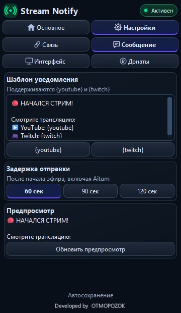
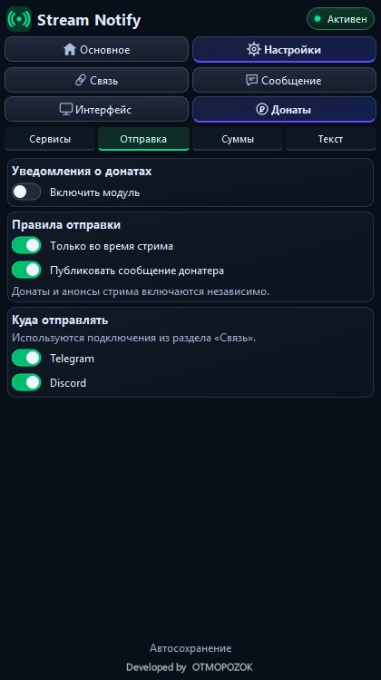
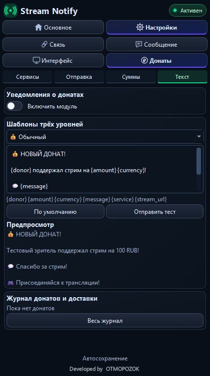

# Stream Notify

**Запускаете эфир — зрители получают ссылки.**

Нативный плагин для **OBS Studio 33.0.0 x64**: анонсы трансляций и уведомления о донатах с сервисов **DonationAlerts** и **DonatePay** с отправкой в **Telegram и Discord**. Работает внутри OBS, включая сетевые выходы **Aitum Multistream**.

[**Скачать тестовую DLL для Windows**](https://github.com/DIMI0007/stream-notify/actions/runs/40084570481/artifacts/12557040604) ·
[Установить или обновить](docs/TEST_WINDOWS_RU.md) ·
[Все сборки](https://github.com/DIMI0007/stream-notify/actions/workflows/build-test-windows.yml)

## Чем полезен стримеру

- **Меньше рутины перед эфиром.** Не нужно каждый раз вручную копировать ссылки в Telegram и Discord: настройте текст и получателей один раз.
- **Удобно для мультистрима.** Запуск второго выхода не создаёт повторный анонс. Плагин учитывает общее состояние потоков OBS/Aitum, а не только кнопку «Начать трансляцию».
- **Есть время передумать.** Выберите задержку 60, 90 или 120 секунд. До отправки текущий анонс можно отменить.
- **Вы управляете рассылкой.** Включайте Telegram и Discord независимо. В Discord можно отдельно разрешить @everyone — тег появится в конце сообщения; по умолчанию упоминание выключено.
- **Донаты напоминают об эфире.** Сообщение о поддержке становится повторным анонсом: показывает активность на стриме и приглашает зрителей присоединиться. Вы выбираете минимальную сумму, текст и получателей.
- **Всё под рукой в OBS.** Компактный док, русский и английский интерфейс, ручные тесты, предпросмотр и результат доставки для каждого канала.

### Донат — повод снова пригласить зрителей

Первый анонс сообщает о начале трансляции. Уведомление о донате напоминает об уже идущем эфире через событие: кто-то поддержал стрим, оставил сообщение — на трансляции есть активность, к которой можно присоединиться.

Добавьте в шаблон ссылку на эфир и приглашение. Такой повторный анонс может заинтересовать тех, кто пропустил старт или отложил просмотр, вернуть их на стрим и помочь увеличить просмотры.

> 💰 Зритель поддержал стрим на 500 RUB!  
> «Спасибо за эфир!»  
> На стриме уже идёт общение — присоединяйтесь: ссылка на трансляцию

Вы сами решаете, какие донаты становятся поводом для анонса: задайте три уровня сумм, свои тексты для каждого уровня и получателей в Telegram и Discord. Пороги задаются в рублях; поддерживаемые валюты пересчитываются по сохранённому справочнику.

### Нативный интерфейс

Плагин использует виджеты Qt и рисованные значки. Для его интерфейса не нужны браузерная страница, Python или отдельный сервер; постоянных декоративных анимаций нет.
Настройки хранятся на вашем компьютере, секреты защищаются Windows DPAPI.
Компактный режим включён по умолчанию, а док можно расположить рядом с чатом и управлением трансляцией.

## Как выглядит

Нажмите на изображение, чтобы открыть полный размер.

<table>
<tr>
<td align="center" valign="top"><b>Основная панель</b>  Статус эфира, ссылки и готовность каналов.</td>
<td align="center" valign="top"><b>Перед отправкой</b>  Обратный отсчёт и отмена текущего анонса.</td>
</tr>
</table>

<b>Подключения, редактор анонса и результат отправки</b>

<table>
<tr>
<td align="center" valign="top"><b>Telegram и Discord</b>  Подключения, ручные тесты и переключатель @everyone.</td>
<td align="center" valign="top"><b>Текст анонса</b>  Редактор сообщения, задержка и предпросмотр.</td>
</tr>
<tr>
<td align="center" valign="top"><b>Результат доставки</b>  Отдельный статус каждого канала и возврат к основной панели.</td>
</tr>
</table>

<b>Донаты: четыре отдельные подвкладки</b>

Длинная страница разделена на **«Сервисы» · «Отправка» · «Суммы» · «Текст»**.
Навигация остаётся видимой при прокрутке; введённые значения не теряются при переходах.
Предпросмотр и ручной тест учитывают настроенные пороги.

<table>
<tr>
<td align="center" valign="top"><b>Сервисы</b>  DonationAlerts и DonatePay, ключи и проверка подключения.</td>
<td align="center" valign="top"><b>Отправка</b>  Кому отправлять и учитывать ли только активный эфир.</td>
</tr>
<tr>
<td align="center" valign="top"><b>Суммы</b>  Три рублёвых порога и справочник курсов.</td>
<td align="center" valign="top"><b>Текст</b>  Шаблоны, предпросмотр, ручной тест и журнал.</td>
</tr>
</table>

Снимки получены из реального Qt-кода в тестовом окне, без настоящих ключей и webhook.
Экран успешной доставки показан на демонстрационных данных.
[Полный набор снимков для разных размеров дока](https://github.com/DIMI0007/stream-notify/actions/runs/40084570481/artifacts/12556791885).

## Установка за несколько шагов

1. Скачайте ZIP и полностью закройте OBS.
2. Скопируйте **папку stream-notify целиком**, включая `bin` и `data`, в:
   `C:\ProgramData\obs-studio\plugins\`.
3. Запустите OBS → **Док-панели → Stream Notify**.
4. В **Настройки → Связь** укажите Telegram-бота/канал и Discord webhook, включите нужные каналы и выполните ручные тесты.
5. Настройте ссылки и текст анонса — затем начинайте эфир через OBS или Aitum.

Правильный путь:
`C:\ProgramData\obs-studio\plugins\stream-notify\bin\64bit\stream-notify.dll`.

При обновлении заменяется папка плагина; сохранённые настройки остаются отдельно.
Если компактный режим раньше выключили, включите его вручную в разделе «Интерфейс».

[Подробная инструкция и диагностика](docs/TEST_WINDOWS_RU.md).

## Донатные сервисы и статус версии

Это **тестовая Windows DLL**, установщика EXE пока нет.

| Часть | Текущий статус |
| --- | --- |
| Telegram и Discord | Пользователь подтвердил успешные тесты анонсов и донатных сообщений |
| OBS / Aitum | Запуск реального стрима проверен пользователем. Дополнительно в CI проверены моделируемые сценарии старта, остановки и защиты от дублей |
| DonationAlerts | Real-time адаптер реализован; получение реальных событий требует проверки на аккаунте |
| DonatePay | Экспериментальный опрос, выключен по умолчанию; схема валюты и приём реальных событий ещё требуют проверки |

Ручной тест донатного сообщения проверяет отправку, а не получение нового доната от сервиса.
Все ключи вводятся только локально в плагине. Ключи и webhook не нужны для CI.

## Документация и проверки

- [Установка, обновление и тестирование](docs/TEST_WINDOWS_RU.md)
- [Модуль донатов и ограничения интеграций](README_DONATIONS_RU.md)
- [Рублёвые пороги и файл курсов](docs/CURRENCY_RU.md)
- [Что проверено](tests/VALIDATION.txt)
- [Журнал актуальной сборки](https://github.com/DIMI0007/stream-notify/actions/runs/40084570481)
- [Архив исходного ТЗ](docs/Stream_Notify_1_0_TZ.md)

CI проверяет сборку, логику валют, Telegram-ссылки, Discord @everyone, навигацию, сохранность значений и неизменность размера окна при переключении донатных вкладок.
Интерфейс проверяется при размерах 290×900, 420×1050 и 360×620; HTTPS — из готового пакета, без отправки сообщений реальным получателям.

## Поддержать разработку

Если Stream Notify пригодился вашим трансляциям, поддержать проект можно добровольным донатом:

- [DonationAlerts](https://www.donationalerts.com/r/otmopozok)
- [DonatePay](https://donatepay.ru/don/OTMOPOZOK)

Спасибо за поддержку!

Developed by [OTMOPOZOK](https://www.youtube.com/channel/UCTAKYR3T2Ud8zZgNShgQfyw/).
