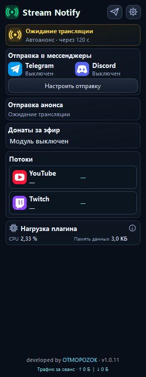
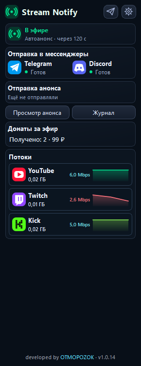

# Stream Notify

**Анонсы эфира и донатов в Telegram и Discord прямо из OBS.** Работает локально, без нашего сервера. [English](docs/README_EN.md).

| Главная | Во время эфира |
| --- | --- |
|  |  |

*Снимки интерфейса 1.0.5 сделаны в изолированном тестовом окружении. Показанные подключения и потоки — демонстрационные данные.*

## Что проверено

- Автоматический анонс при реальном эфире доставлен и в Telegram, и в Discord.
- Вход в DonationAlerts через браузер подтверждён. Повтор ранее полученного доната отправил уведомления в оба места; новый реальный платёж после подключения ещё не проверен.
- Ключ DonatePay принят API, соединение установлено. Доставка нового реального доната ещё не проверена.
- Версия 1.0.5 собрана и прошла автоматические тесты интерфейса. График битрейта и плашка LIVE требуют проверки на настоящем эфире в OBS.

## Возможности

- Один анонс при запуске трансляции, в том числе при нескольких выходах OBS/Aitum.
- Отдельные настройки Telegram и Discord, ручная отправка и тест доставки.
- Уведомления о донатах DonationAlerts и DonatePay с настраиваемыми порогами и текстом.
- Отдельная карточка каждого потока: LIVE, битрейт, график последних **30 минут** и переданные ГБ. Данные завершённого потока остаются видны до следующего запуска выхода.
- Локальное хранение настроек; секреты защищены средствами Windows.

## Установка

1. Закройте OBS.
2. [Скачайте архив последней успешной сборки](https://github.com/DIMI0007/stream-notify/actions/workflows/build-test-windows.yml).
3. Скопируйте всю папку `stream-notify` из архива в `C:\ProgramData\obs-studio\plugins\`. При обновлении замените папку целиком.
4. Запустите OBS, откройте **Stream Notify**, настройте получателей и нажмите тестовые кнопки.

Поддерживаемая тестовая конфигурация: **OBS 33.0.0, Windows x64**. Архив пока не подписан цифровой подписью. Версия и ревизия исходников указаны в `BUILD_INFO.json`.

[Лицензия GPL v2](LICENSE) · [Конфиденциальность](PRIVACY.md) · [Подробная инструкция по донатам](README_DONATIONS_RU.md)

Разработчик: [OTMOPOZOK](https://www.youtube.com/channel/UCTAKYR3T2Ud8zZgNShgQfyw/).
