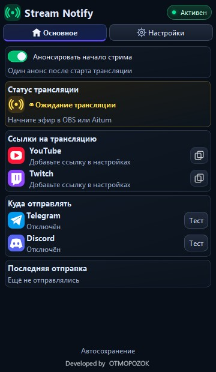
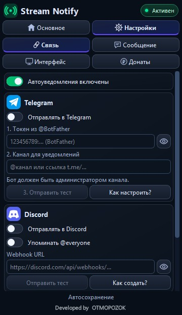
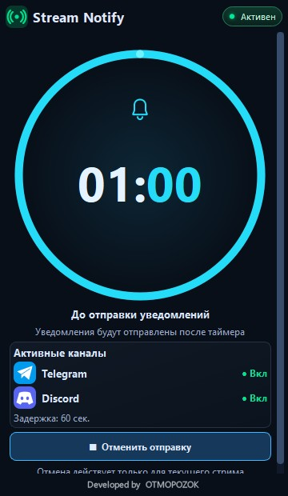
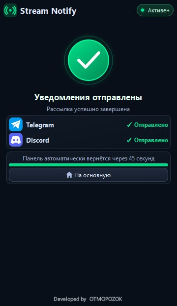

# Stream Notify

Нативный плагин для **OBS Studio 33.0.0 x64**: анонсы трансляций и уведомления о донатах с сервисов **DonationAlerts** и **DonatePay** с отправкой в **Telegram и Discord**. Работает внутри OBS, включая сетевые выходы **Aitum Multistream**.

[Сборки Windows](https://github.com/DIMI0007/stream-notify/actions/workflows/build-test-windows.yml) ·
[Установка и обновление](docs/TEST_WINDOWS_RU.md) ·
[Донаты](README_DONATIONS_RU.md) · [Валюты](docs/CURRENCY_RU.md)

## Скриншоты

Реальный интерфейс плагина в компактном доке. Снимки получены из Qt-кода в тестовом окне:
настоящие токены и webhook не используются; результат отправки показан на демонстрационных данных.
Нажмите на изображение, чтобы открыть его в полном размере.

<table>
<tr>
<td align="center" valign="top"><b>Основная панель</b>  Статус эфира, ссылки и получатели уведомлений.</td>
<td align="center" valign="top"><b>Подключения</b>  Настройка каналов и переключатель @everyone.</td>
</tr>
<tr>
<td align="center" valign="top"><b>Отсчёт перед отправкой</b>  Обратный отсчёт и отмена текущего анонса.</td>
<td align="center" valign="top"><b>Результат отправки</b>  Отдельный результат доставки для каждого канала.</td>
</tr>
</table>

[Все 27 снимков, включая донаты и разные размеры дока](https://github.com/DIMI0007/stream-notify/actions/runs/40081330317/artifacts/12555407207).

## Поддержать разработку

Если Stream Notify помогает вашим трансляциям, поддержать разработку можно добровольным донатом:

- [Поддержать через DonationAlerts](https://www.donationalerts.com/r/otmopozok)
- [Поддержать через DonatePay](https://donatepay.ru/don/OTMOPOZOK)

Спасибо за поддержку проекта!

## Возможности

- Один анонс после начала эфира; задержка 60, 90 или 120 секунд, отмена текущей рассылки.
- Общее состояние нескольких выходов: второй выход не дублирует анонс, остановка одного не завершает сессию.
- Telegram-бот и Discord webhook, независимые ручные тесты и статусы доставки.
- Переключатель **«Упоминать @everyone»** в настройках Discord: добавляет тег в конец анонсов, донатных сообщений и тестов. По умолчанию выключен.
- Три уровня донатов с рублёвыми порогами, шаблонами и предпросмотром.
- Пересчёт валют по сохранённому справочнику; без постоянного обновления курсов.
- RU/EN, компактный режим по умолчанию, тёмные карточки, рисованные значки и переключатели.
- Локальные настройки; секреты защищены Windows DPAPI.

## Состояние

Тестовая DLL собирается в GitHub Actions. Пользователь подтвердил работу отправки в Telegram и Discord, включая тесты анонсов и донатных сообщений.
CI проверяет логику валют, Telegram-ссылки, Discord payload, Qt-интерфейс, моделируемые сценарии нескольких выходов и HTTPS из готового пакета.
Ключи и сообщения для реальных получателей в CI не используются.

**DonationAlerts**: код real-time адаптера реализован; получение реальных событий требует проверки на аккаунте.
**DonatePay**: экспериментальный опрос API, выключен по умолчанию. Входящие события и схема валюты пока не подтверждены; WebSocket DonatePay ещё не реализован.
Установщика EXE пока нет.

## Быстрый старт

1. Скачайте ZIP из последней успешной сборки Actions: `StreamNotify-Test-DLL-OBS33-Windows-x64`.
2. Полностью закройте OBS.
3. Скопируйте **папку stream-notify целиком**, включая bin и data, в:
   `C:\ProgramData\obs-studio\plugins\`.
4. Запустите OBS → **Док-панели → Stream Notify**.
5. В разделе **Настройки → Связь** введите токен Telegram и канал, Discord webhook. Выполните ручные тесты.

Нужный путь: `C:\ProgramData\obs-studio\plugins\stream-notify\bin\64bit\stream-notify.dll`.
Не оставляйте дополнительную внешнюю папку с названием ZIP.

Сохранённые настройки не перезаписываются: если компактный режим раньше был выключен, включите его вручную.
Токены вводятся только локально. Не публикуйте settings.json, ключи, webhook или скриншоты с открытыми секретами.

## Документация

- [Установка, обновление и тестирование](docs/TEST_WINDOWS_RU.md)
- [Модуль донатов и ограничения интеграций](README_DONATIONS_RU.md)
- [Рублёвые пороги и файл курсов](docs/CURRENCY_RU.md)
- [Что проверено](tests/VALIDATION.txt)
- [Архив исходного ТЗ](docs/Stream_Notify_1_0_TZ.md)

Developed by [OTMOPOZOK](https://www.youtube.com/channel/UCTAKYR3T2Ud8zZgNShgQfyw/).

## Актуальная тестовая сборка

[Скачать ZIP для OBS 33](https://github.com/DIMI0007/stream-notify/actions/runs/40081330317/artifacts/12555900195) ·
[27 снимков интерфейса](https://github.com/DIMI0007/stream-notify/actions/runs/40081330317/artifacts/12555407207) ·
[Журнал сборки](https://github.com/DIMI0007/stream-notify/actions/runs/40081330317)

В этой версии: переключатель @everyone, рисованные значки навигации, новый индикатор активности,
компактные строки ссылок, адаптивный таймер и отдельная карточка результата с возвратом на основную.
Проверены размеры 290×900, 420×1050 и 360×620.
Выполнены три набора CTest, Qt-проверки во всех трёх размерах и HTTPS-проверки Telegram/Discord.

Интерфейс построен на нативных виджетах Qt и QPainter, без WebView, видеоресурсов и постоянных декоративных анимаций.
Таймеры отсчёта/возврата работают только на соответствующих экранах; состояние сетевых выходов проверяется раз в секунду.
Это описание архитектуры, а не измерение потребления CPU/GPU внутри OBS.
