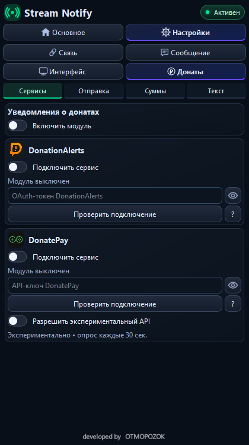
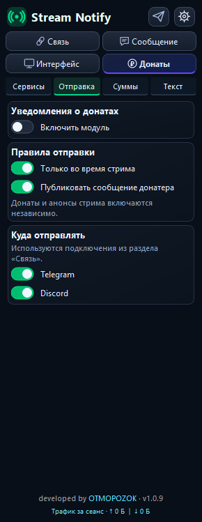
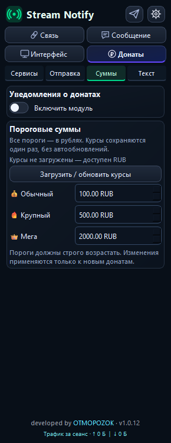
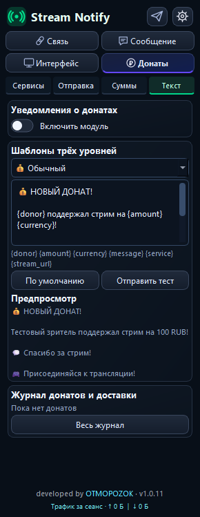

# Stream Notify — уведомления о донатах

Донатные сообщения работают как **повторные анонсы активного эфира**. Поддержка зрителя и его сообщение дают повод напомнить о трансляции, показать происходящую на ней активность и снова пригласить аудиторию.

Добавьте в шаблон ссылку на стрим и приглашение присоединиться. Такое сообщение может заинтересовать тех, кто пропустил старт, вернуть их на эфир и помочь увеличить просмотры. Минимальная сумма, три уровня шаблонов и получатели настраиваются вами.

## Интерфейс
Настройки → Донаты. Общий переключатель модуля виден в начале каждого раздела.
Под ним четыре компактные подвкладки:

| Подвкладка | Содержимое |
| --- | --- |
| Сервисы | DonationAlerts, DonatePay, скрытые ключи, проверка подключения и экспериментальный режим DonatePay |
| Отправка | Только во время стрима, текст донатера, получатели Telegram/Discord |
| Суммы | Три порога в RUB, файл курсов и ручное обновление справочника |
| Текст | Шаблоны трёх уровней, предпросмотр, ручной тест и журнал доставки |

Навигация остаётся видимой при прокрутке. Выбранная подвкладка сохраняется при перестроении панели.
Редактирование шаблона и порогов не теряется при переходах.
Предпросмотр и ручной тест используют настроенную сумму соответствующего уровня.
Ручной тест не создаёт запись реального доната в журнале.
Переключатель @everyone в настройках Discord применяется и к донатным сообщениям.

<table>
<tr>
<td align="center" valign="top"><b>Сервисы</b>  DonationAlerts и DonatePay, ключи и проверка подключения.</td>
<td align="center" valign="top"><b>Отправка</b>  Кому отправлять и учитывать ли только активный эфир.</td>
</tr>
<tr>
<td align="center" valign="top"><b>Суммы</b>  Три рублёвых порога и справочник курсов.</td>
<td align="center" valign="top"><b>Текст</b>  Шаблоны, предпросмотр, ручной тест и журнал.</td>
</tr>
</table>

Снимки из тестового Qt-окна, без реальных ключей.

## Что означает статус сервиса

- **Модуль выключен** — включите общий переключатель вверху раздела донатов.
- **Сервис выключен** — включите «Подключить сервис» в нужной карточке.
- **Введите токен** — добавьте OAuth-токен DonationAlerts или API-ключ DonatePay.
- **Неверный формат OAuth-токена** — в поле DonationAlerts вставлен текст с пробелами или неподходящими символами; скопируйте именно OAuth access token из DonationAlerts.
- **Ожидание трансляции** — включено правило «Только во время стрима». Начните эфир либо снимите это ограничение в подвкладке «Отправка» для проверки.
- **API требует проверки** — для DonatePay требуется разрешить экспериментальный API и проверить совместимость на своём аккаунте.
- **Ответ API не распознан** — DonatePay ответил, но структура не совпала с ожидаемой. Автоопрос останавливается, чтобы не создавать лишние запросы; проверьте ключ и совместимость метода, затем нажмите «Проверить подключение» ещё раз.

Кнопка «?» рядом с проверкой подключения открывает информацию о ключе.
При отсутствии нужного условия проверка объясняет следующий шаг вместо молчаливого бездействия.

## DonationAlerts
Реализован адаптер /user/oauth, /centrifuge/subscribe и Centrifugo WebSocket.
OAuth-токен вводится локально; нужны scopes oauth-user-show и oauth-donation-subscribe.
**Токен виджета оповещений не является OAuth access token.** Он работает в виджете OBS,
но запросы `/api/v1/user/oauth` с ним получают отказ. Нужен токен приложения,
выданный через [OAuth DonationAlerts](https://www.donationalerts.com/apidoc)
с разрешениями `oauth-user-show` и `oauth-donation-subscribe`. Сам токен не публикуйте.
Получение реальных событий и обработку разрывов нужно проверить на аккаунте.

## DonatePay
Используется экспериментальный опрос DonatePay **donatepay.ru**, не одноимённых сервисов.
В поле токена вводится API-ключ access_token со страницы https://donatepay.ru/page/api после входа.
Нужны включённые модуль, сервис и разрешение экспериментального API.

По предоставленной документации уточнены имя what, сумма sum, type=donation и status=success.
Тестовые, отменённые, ожидающие и неизвестные операции не должны объявляться.
Первое чтение создаёт исходную отметку: старые донаты не рассылаются.
Опрос выполняется через 30 секунд с увеличением интервала при ошибках.

Актуальный полный URL метода, поле валюты и реальное поведение требуют проверки на аккаунте.
При отсутствии валюты отправка пропускается; RUB не назначается автоматически.
Опрос последних 100 записей не гарантирует полноту при большом потоке.
WebSocket endpoint известен из документации, но адаптер DonatePay WebSocket пока не реализован.

## Пороги и доставка
Все пороги — в рублях, по умолчанию 100 / 500 / 2000.
[Правила пересчёта и файл курсов](docs/CURRENCY_RU.md).

Локальный donation-ledger.json сохраняет состояние доставки каждому получателю.
Перед POST фиксируется inflight; после подтверждения — sent.
После обрыва с неизвестным результатом повтор автоматически не выполняется.
Повторные ID не должны создавать новый анонс.
Настройка «Только во время стрима» учитывает общее состояние сетевых выходов OBS/Aitum.

## Что подтверждено
Windows DLL собирается; CI проверяет логику и HTTPS.
Пользователь подтвердил успешные тесты отправки донатных сообщений в Telegram/Discord.
Это не заменяет проверку приёма настоящего нового доната DonationAlerts/DonatePay.
Ключи и webhook не добавляются в CI и не пересылаются через чат.

